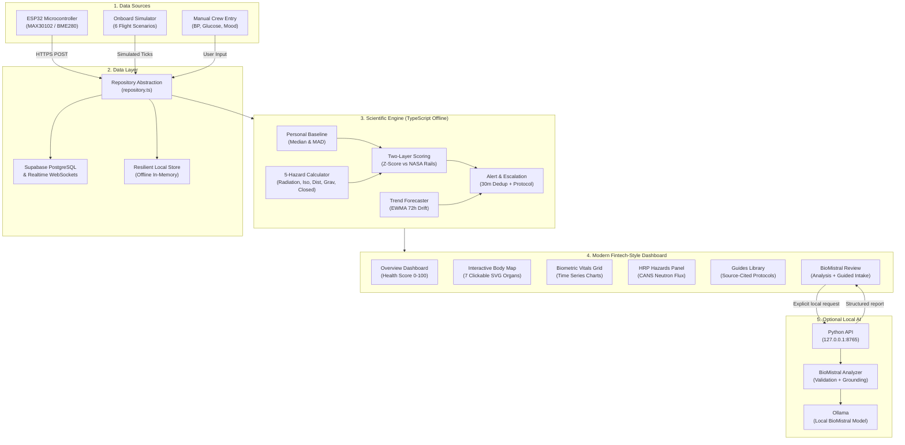

# Badr Health — Autonomous Health Monitoring for Astronauts

> **NASA Space Apps Challenge Dakar 2026**  
> **Challenge**: "Create Health Monitoring Software for Astronauts on Space Missions"  
> **Team**: Badr Health  
> **Target Environments**: Low Earth Orbit (Space Station), Deep Space Transit (Spacecraft), Lunar Surface Base (Moon)

---

## 1. Project Purpose

During long-duration missions to the Moon and deep space, crews operate beyond the safety of Earth’s magnetosphere and face multi-minute communication latencies that preclude real-time medical direction from ground flight surgeons. Astronauts must take personal responsibility for monitoring their physiological adaptations, recognizing early pathological drift, and initiating autonomous countermeasures.

**Badr Health** is a resilient decision-support web application and telemetry pipeline designed specifically for interplanetary spaceflight. It ingests biometrics from physical sensors (or an onboard simulator), scores them against an astronaut's personal baseline using robust non-parametric statistics, dynamically adjusts risk weights based on the active spaceflight environment, and delivers actionable, source-cited clinical guidance.

---

## 2. Architecture Diagram



---

## 3. Quick Start (< 5 minutes)

### Prerequisites
- Node.js v18+ (tested on Node.js v24)
- npm or pnpm

### Installation & Run
```bash
# 1. Clone the repository
git clone https://github.com/your-team/badr-health.git
cd badr-health

# 2. Install dependencies (first run only)
npm install

# 3. Start local development server
npm run dev
```

Open [http://localhost:3000](http://localhost:3000) in your browser.  
The application launches automatically in **Offline demo mode** with zero configuration required.

**Windows:** after the first setup, simply double-click
[`LANCER_BADR_HEALTH.bat`](./LANCER_BADR_HEALTH.bat). It installs the website
dependencies if needed, opens the site in your browser, and starts the optional
local BioMistral API when its virtual environment and Ollama are ready.

### Run Unit Tests
```bash
npm test
```

### Production Build
```bash
npm run build
```

### Supabase (Optional)

Apply `supabase/schema.sql`, the SQL files in `supabase/migrations/` in filename
order, and `supabase/seed.sql` in the Supabase SQL Editor. Copy the project URL
and anon/publishable key from **Project Settings → API** into a root-level
`.env.local` file:

```env
VITE_SUPABASE_URL=https://your-project-ref.supabase.co
VITE_SUPABASE_ANON_KEY=your-anon-or-publishable-key
```

Do not use a `service_role` key in the browser or commit `.env.local`. Restart
`npm run dev` after changing environment variables. The dashboard loads readings
and alerts from Supabase, sends manual readings and check-ins, persists alerts,
and subscribes to Realtime updates. Simulator ticks remain local to avoid
writing a new batch every few seconds. The demo RLS migration permits anonymous
access and is suitable only for fictional demo data.

---

## Local BioMistral AI (Optional)

BioMistral is an optional, local decision-support service. It runs in Python and
uses the BioMistral model through Ollama on the same computer. The browser sends
the selected measurement snapshot only to `127.0.0.1`; there is no cloud AI
provider or remote API. The existing dashboard and deterministic alerts work
whether or not Ollama is running.

### One-time setup

Requirements: Python 3.11 or newer and Ollama. From the project folder, install
the Python dependencies and download the model:

```powershell
py -3.11 -m venv .venv-biomistral
.\.venv-biomistral\Scripts\python.exe -m pip install -r requirements-biomistral.txt
ollama pull m/biomistral
```

Keep Ollama running (the Ollama desktop app or `ollama serve`). Start the
BioMistral API in one terminal:

```powershell
.\.venv-biomistral\Scripts\python.exe -m biomistral.api
```

Start Badr Health with `npm run dev`, then open **Other Systems → BioMistral AI
Review**. On Windows, [`LANCER_BADR_HEALTH.bat`](./LANCER_BADR_HEALTH.bat)
starts the API automatically when the Python environment and Ollama are ready.
It can prepare the Python environment when `uv` is installed. Otherwise, start
the API manually with the command above. The API binds only to localhost on port `8765`. `OLLAMA_HOST` must remain a
local address. The default model tag is `m/biomistral` and can be changed with
`BIOMISTRAL_MODEL`.

If Ollama is running but the AI page says the model is unavailable, install the
model once from a terminal with `ollama pull m/biomistral` (about 4.4 GB), then
click **Check again** on the AI review page. Installing the Ollama application
alone does not download the model.

The review page supports a structured analysis of current readings and a guided
symptom intake. The intake collects symptom text and optional duration/intensity;
it is not a free-form medical chatbot. Missing measurements are not invented.
Reports show model validation warnings and screening flags separately. An
`SIMULATED` label is shown when demo telemetry is included. This AI-assisted
integration is decision support only, not a diagnosis or replacement for a
qualified flight surgeon. Integration code was generated with AI assistance;
the BioMistral package and its tests were supplied in the project archive.

Run the local API bridge tests with `uv`:

```powershell
uv run --python 3.11 --with-requirements requirements-biomistral.txt --with pytest python -m pytest biomistral\tests\test_api.py
```

---

## 4. Environments & Scenarios

### Dynamic Flight Environments
Switchable in real-time from the header:
1. **Space Station (LEO)**: Microgravity ($0.00g$), $0.6s$ ground latency, Earth magnetosphere shielding. Emphasizes bone/muscle loss countermeasures.
2. **Deep Space Transit**: Microgravity ($0.00g$), $145s$ comms delay. Autonomous emergency protocols are prioritized before ground contact. Supreme radiation hazard ($35\%$ weight).
3. **Lunar Surface Base**: Partial gravity ($0.165g$), $1.3s$ latency. Monitored for lunar regolith dust toxicity and solar flare exposure.

### Demonstration Scenarios (Hotkey `Shift+D`)
1. **Nominal Baseline**: Optimal crew vitals with natural 24h circadian rhythm.
2. **Hypoxia Event**: SpO₂ drops steadily below 92%, triggering acute tachycardia and autonomous emergency O₂ mask protocols.
3. **Solar Particle Event (SPE)**: Dosimeter spikes to 280 µSv/h with high neutron flux, activating storm shelter retreat procedures.
4. **Sleep Deprivation Streak**: Sleep drops below 5h for multiple cycles, triggering psychological fatigue warnings.
5. **Blood Pressure Drift**: Systolic pressure creeps upward, caught by the 72h exponential trend forecaster.
6. **High Cabin CO₂**: Ambient CO₂ exceeds 5,000 ppm, signaling life-support scrubber canister saturation.

---

## 5. Hardware Ingestion

An ESP32 microcontroller firmware sketch is provided in `hardware/esp32_vitals.ino`.  
Alternatively, stream telemetry from your terminal using the Python simulator:
```bash
python tools/simulate.py nominal 2.5
```

---

## 6. Regulatory & Ethical Disclaimers

> **IMPORTANT MEDICAL DISCLAIMER**  
> **Decision-support tool. It does not replace a flight surgeon and does not provide medical diagnoses.**  
> Badr Health is designed to assist astronauts in structured self-assessment and autonomous triage in communications-denied spaceflight environments.

- **Data Transparency**: All synthetic telemetry is labeled with a visible `SIMULATED` badge in the UI and stored with `source = 'simulated'`.
- **Space Agency Compliance**: Contains zero NASA logos, meatballs, or official seals. NASA and Canadian Space Agency (CSA) resources are cited as plain text and hyperlink citations.
- **Privacy**: No depictions or references to minors or real individuals. All astronaut profiles are fictional adult callsigns.
